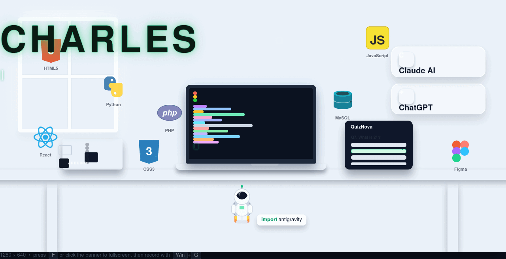

# 👋 Hi, I'm Charles

### BSIT Student & Full-Stack Developer

**Turning clean code into apps people actually enjoy using 🚀**

---

## 🎓 About Me

> **Objective:** Grow into a full-stack developer by turning classroom concepts into real, working products.

- 🎓 Currently taking **BS Information Technology** — major focus on software & web development
- 💻 **Full-stack in training:** polished front-ends (React, Figma) backed by solid systems (PHP, MySQL)
- 🤖 Hardware tinkerer — blinking LEDs, sensors, and **Arduino** weekend projects
- 🌱 Currently leveling up in **React patterns**, **Python automation**, and clean Git workflows
- ✨ Pair-programming with **Claude AI** & **ChatGPT** (they review my PRs at 2 AM)
- ✨ Fun fact: `import antigravity` — every bug becomes an adventure

---

## 🛠️ Tech Stack

**🎨 Frontend**

**⚙️ Backend & Data**

**🤖 Design & Hardware**

**🧰 Tools & AI**

---

## 📌 Featured Projects

### 🌌 QuizNova — Interactive Quiz App

| | |
|:--|:--|
| **Role** | Designer & Full-stack Developer |
| **Stack** | React · PHP · MySQL · Figma |
| **Status** | 🚧 In development |
| **Highlights** | Figma-first UI · instant scoring · responsive from phone to desktop |

### 🌱 GreenSense — Arduino Plant Monitor *(coming soon)*

| | |
|:--|:--|
| **Role** | Hardware & Firmware |
| **Stack** | Arduino · Python · MQTT |
| **Status** | 📝 Planning |
| **Highlights** | Soil moisture sensors that nudge you before your plant gives up |

> 💡 More projects are brewing — check my [repositories](https://github.com/charless-devs?tab=repositories).

---

## 📊 GitHub Stats

  
  
   
  

---

## 🐍 My Contribution Grid

<picture>
  <source media="(prefers-color-scheme: dark)" srcset="https://raw.githubusercontent.com/charless-devs/charless-devs/gh-pages/snake-dark.svg">
  
</picture>

---

## 📫 Let's Connect

*Always learning · Always building · Always growing* 🌱

