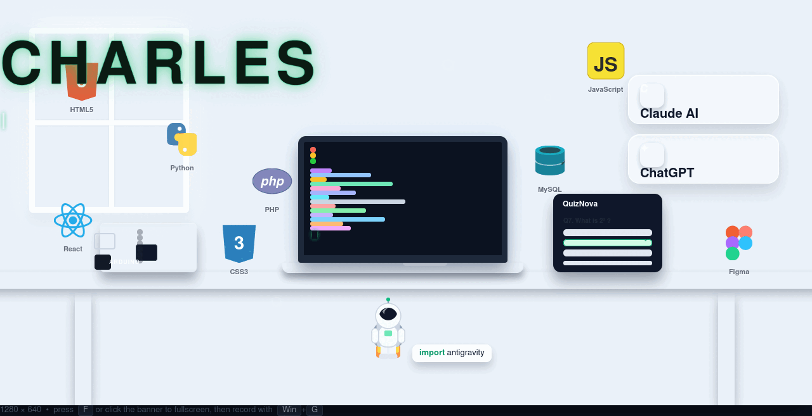

# GitHub Profile Setup Guide — @charless-devs

> Complete, professional GitHub profile setup: special repository, resume-style
> README, animated typing SVG, custom skill badges, and automated snake animation.

---

## Part 1 — Special repository (already done ✅)

1. Repository name must equal the username **exactly**: `charless-devs/charless-devs`
   (GitHub shows a 🎉 message when the name matches your username)
2. **Public** visibility is required for profile READMEs
3. ✅ "Add a README file" initializes `README.md` on `main`
4. Your older `charles-devs` repo was **renamed** to `charless-devs`
   (GitHub redirects the old URL automatically)

**Files in the profile repo:**

| File | Purpose |
|:--|:--|
| `README.md` | The profile page content |
| `banner.gif` | Animated header banner |
| `assets/typing.svg` | Animated typing tagline |
| `.github/workflows/snake.yml` | Daily contribution-snake generator |

---

## Part 2 — README.md (resume structure)

```markdown
<div align="center">



# 👋 Hi, I'm Charles

### BSIT Student & Full-Stack Developer


**Turning clean code into apps people actually enjoy using 🚀**


</div>

---

## 🎓 About Me

> **Objective:** Grow into a full-stack developer by turning classroom concepts into real, working products.

- 🎓 Currently taking **BS Information Technology** — major focus on software & web development
- 💻 **Full-stack in training:** polished front-ends (React, Figma) backed by solid systems (PHP, MySQL)
- 🤖 Hardware tinkerer — blinking LEDs, sensors, and **Arduino** weekend projects
- 🌱 Currently leveling up in **React patterns**, **Python automation**, and clean Git workflows
- ✨ Pair-programming with **Claude AI** & **ChatGPT** (they review my PRs at 2 AM)
- ✨ Fun fact: `import antigravity` — every bug becomes an adventure

---

## 🛠️ Tech Stack

<p align="center">

**🎨 Frontend**


**⚙️ Backend & Data**


**🤖 Design & Hardware**


**🧰 Tools & AI**


</p>

---

## 📌 Featured Projects

### 🌌 QuizNova — Interactive Quiz App

| | |
|:--|:--|
| **Role** | Designer & Full-stack Developer |
| **Stack** | React · PHP · MySQL · Figma |
| **Status** | 🚧 In development |
| **Highlights** | Figma-first UI · instant scoring · responsive from phone to desktop |

### 🌱 GreenSense — Arduino Plant Monitor *(coming soon)*

| | |
|:--|:--|
| **Role** | Hardware & Firmware |
| **Stack** | Arduino · Python · MQTT |
| **Status** | 📝 Planning |
| **Highlights** | Soil moisture sensors that nudge you before your plant gives up |

> 💡 More projects are brewing — check my [repositories](https://github.com/charless-devs?tab=repositories).

---

## 📊 GitHub Stats

<div align="center">
  
  
  <br/>
  
</div>

---

## 🐍 My Contribution Grid

<div align="center">

<picture>
  <source media="(prefers-color-scheme: dark)" srcset="https://raw.githubusercontent.com/charless-devs/charless-devs/gh-pages/snake-dark.svg">
  
</picture>

</div>

---

## 📫 Let's Connect

<div align="center">

[](mailto:charles.dev@email.com)
[](https://linkedin.com/in/charless-devs)
[](https://github.com/charless-devs)

*Always learning · Always building · Always growing* 🌱

</div>
```

**Customizing skill badges:** every badge is a shields.io URL —
`https://img.shields.io/badge/<NAME>-<LEVEL>-<COLOR>?style=for-the-badge&logo=<logo>&logoColor=<color>`
Keep the level text honest (Advanced / Intermediate / Learning 🌱 / Tinkering).

---

## Part 3 — Animated typing SVG (`assets/typing.svg`)

Pure SVG animation (SMIL) — no JavaScript, animates for every visitor once hosted.

```svg
<svg xmlns="http://www.w3.org/2000/svg" viewBox="0 0 560 64" width="560" height="64"
     role="img" aria-label="BSIT Student and Full-Stack Developer">
  <style>
    .txt   { font-family: "Segoe UI", Inter, system-ui, sans-serif;
             font-size: 26px; font-weight: 600; fill: #334155; }
    .caret { fill: #10b981; }
  </style>
  <clipPath id="reveal">
    <rect x="8" y="10" height="44" width="0">
      <animate attributeName="width" dur="7s" repeatCount="indefinite"
               keyTimes="0; 0.42; 0.80; 0.92; 1"
               values="0; 452; 452; 0; 0"/>
    </rect>
  </clipPath>
  <text class="txt" x="8" y="42" clip-path="url(#reveal)">BSIT Student &amp; Full-Stack Developer</text>
  <rect class="caret" x="8" y="16" width="3" height="30" rx="1.5">
    <animate attributeName="x" dur="7s" repeatCount="indefinite"
             keyTimes="0; 0.42; 0.80; 0.92; 1"
             values="8; 460; 460; 8; 8"/>
    <animate attributeName="opacity" dur="1s" repeatCount="indefinite"
             keyTimes="0; 0.5; 0.51; 1" values="1; 1; 0; 0"/>
  </rect>
</svg>
```

---

## Part 4 — Snake animation workflow (`.github/workflows/snake.yml`)

**How it works:** GitHub Actions regenerates the contribution snake daily (00:00 UTC),
on every push, or manually — publishing light + dark SVGs to the `gh-pages` branch,
which the README embeds via `<picture>` (dark-mode aware).

**Setup steps:**
1. **Settings → Actions → General → Workflow permissions** → "Read and write permissions" → Save
2. Commit the workflow file below to `.github/workflows/snake.yml`
3. **Actions** tab → run the workflow once manually (it also auto-runs on push)
4. Refresh the profile — the snake appears (404 only before the first run)

```yaml
name: 🐍 Generate contribution snake

on:
  schedule:
    - cron: "0 0 * * *"   # regenerate daily at 00:00 UTC
  workflow_dispatch:       # allows manual "Run workflow"
  push:
    branches: [main]       # refresh whenever README changes

permissions:
  contents: write          # lets the workflow publish to gh-pages

jobs:
  generate-snake:
    runs-on: ubuntu-latest
    timeout-minutes: 10

    steps:
      - name: 🐍 Generate the contribution graph
        uses: Platane/snk/github-action@v3
        with:
          github_user_name: ${{ github.repository_owner }}
          outputs: |
            dist/snake.svg?color_snake=#10b981
            dist/snake-dark.svg?palette=github-dark&color_snake=#10b981

      - name: 📦 Publish images to the gh-pages branch
        uses: peaceiris/actions-gh-pages@v3
        with:
          github_token: ${{ secrets.GITHUB_TOKEN }}
          publish_dir: dist
```

> 💡 Snake green `#10b981` matches the profile accent theme.
> CLI note: pushing workflow files requires the GitHub CLI `workflow` scope
> (`gh auth refresh -h github.com -s workflow`).

---

## ✅ Final verification checklist

- [ ] Repo `charless-devs/charless-devs` is **public**
- [ ] `README.md` on `main` — banner, typing SVG, badges render
- [ ] `assets/typing.svg` animates in the header
- [ ] `banner.gif` renders at the top
- [ ] `.github/workflows/snake.yml` present and first run succeeds (green ✔)
- [ ] Workflow permissions = "Read and write"
- [ ] Placeholder email/LinkedIn links updated
- [ ] Stats cards populate as commits accumulate
